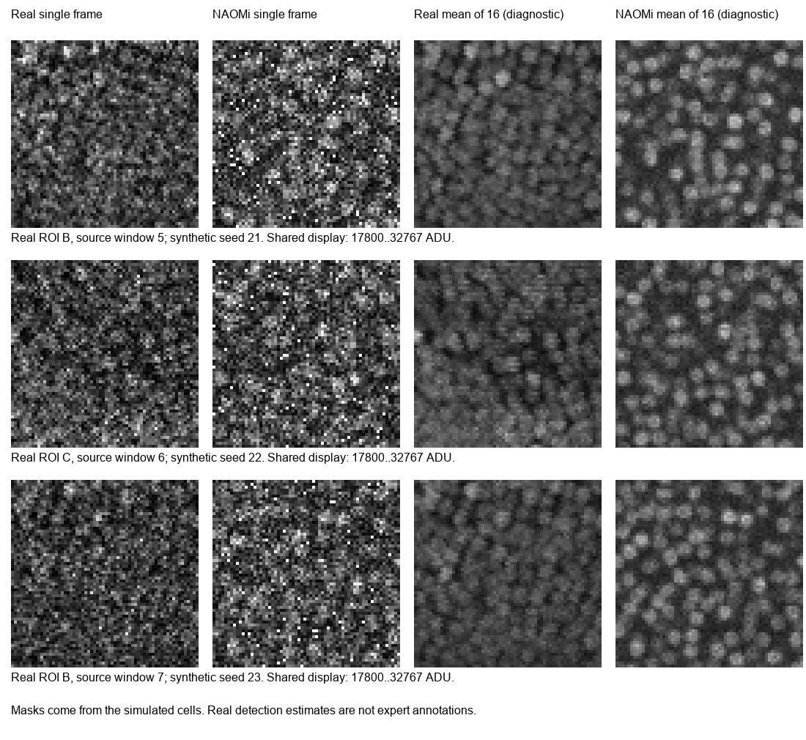
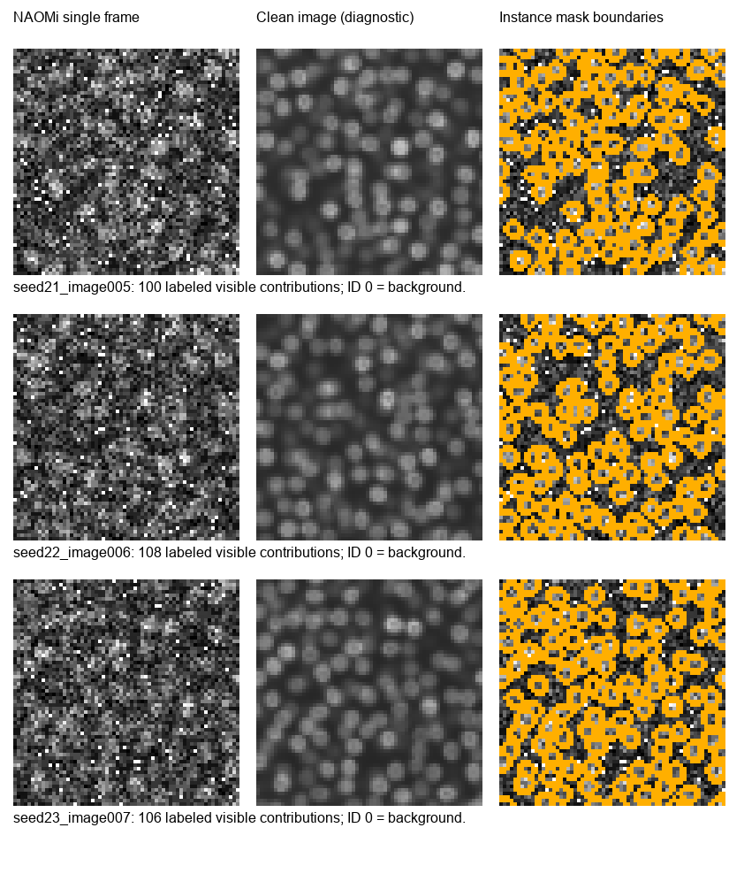

# NaomiGen

Генерация синтетических изображений кальциевой флуоресценции zebrafish и масок клеток на основе адаптированного NAOMi. Параметры настроены по локальным вырезкам из [Zenodo 6293696](https://zenodo.org/records/6293696).

Два режима: локальные картинки **64×64** и полный кадр **400 строк × 485 столбцов** с масками клеток.

## Полный кадр 400×485 — один скрипт

Из корня репозитория, в PowerShell с установленным Python 3.12:

```powershell
python .\generate_full_frame.py --count 4 --seed 42
```

Скрипт сам использует `.venv` и при необходимости создаёт её через `Setup.ps1`. Результат — в `outputs/full_400x485_.../`: `images/`, `instance_masks/`, `semantic_masks/`, `clean/`, `overlap_masks/`, параметры и `verification.json`. Файл `full_seed42_comparison.png` показывает реальный кадр, синтетический и разметку. Для другого набора измените `--seed`; количество задаёт `--count`.

Метод: отдельные оптические вклады клеток из сохранённых сцен NAOMi размещаются по всему кадру. Крупная форма мозга, тёмные полости и яркие протяжённые структуры задаются шаблоном из первых пяти временных фрагментов референса. Камера использует составной Poisson-шум с непрерывным усилением и Gaussian-шум чтения. При каждом запуске проверяются экспорт TIFF, согласованность масок, выбор клетки при перекрытиях и сходство по 12 инженерным критериям. Для сопоставления по умолчанию выбран более поздний фрагмент `--window 5`; доступны также `6` и `7`.

Это приближённая генерация полного изображения из компонентов NAOMi; единый 3D-объём всей рыбы не рассчитывается. Пространственный шаблон и банк форм общие для всех результатов, поэтому разные seed не означают независимых рыб. Octave для этого режима не нужен. В `overlap_masks/*.npz` маски хранятся разреженно: `row`, `col`, `cell_id`, `contribution_adu`, `image_shape`.

Если проверка сходства не пройдена, данные сохраняются, отчёт показывает отклонения, а скрипт завершится с кодом `2`. Код `0` означает, что все заданные проверки пройдены; код `1` — ошибку выполнения. Выходная папка должна быть новой. Сгенерированные данные в `outputs/` исключены из Git.

Проверено на 8 полных кадрах: экспорт и маски корректны во всех случаях, 7 из 8 прошли все 12 допусков сходства. В одном примере ошибка числа автоматически найденных объектов — 25,07% при допуске 25%. Повторный запуск с теми же seed дал идентичные 16 TIFF; четыре кадра seed 42–45 рассчитаны примерно за 6 секунд на рабочем компьютере. Это инженерная проверка на одной записи рыбы.

## Локальные картинки 64×64 — Windows / PowerShell

Установите **Python 3.12**, отметив **Add python.exe to PATH**. Затем:

```powershell
git clone https://github.com/BorjomiMen/NaomiGen.git
cd NaomiGen
.\Run.cmd
```

Если репозиторий уже скачан, достаточно запустить `Run.cmd` из его папки.

При первом запуске скрипт создаст `.venv` и установит зависимости. По умолчанию генерируются **24 изображения**: три сохранённые сцены, seed `21`, `22`, `23`, по восемь вариантов каждой. Для этого режима MATLAB и Octave не требуются: готовые оптические вклады клеток включены в репозиторий. Для построения новых сцен с другими seed нужен GNU Octave с пакетами `image`, `statistics`, `signal`, `splines` и компилятором MEX.

## Где результат

Новый набор появится в `naomi_zenodo_stage1/generated/batch_.../`:

- `images/` — изображения TIFF, `uint16`;
- `instance_masks/` — маски отдельных клеток: `0` — фон, остальные значения — ID клетки;
- `semantic_masks/` — бинарные маски клеток;
- `comparison.png`, `masks_preview.png` — сравнение с реальными данными и просмотр разметки;
- `manifest.json`, `verification.json` — параметры, seed и результаты проверки.

Проверка запускается автоматически. В `verification.json` успешный результат содержит `"export_integrity_passed": true` и `"similarity_checks_passed": true`. Это проверка целостности файлов и выбранных характеристик изображений; биологическая реалистичность временной активности здесь не оценивается.

Пары для обучения — файлы с одинаковыми именами из `images/` и папки нужных масок. При разделении на обучение и тест используйте разные seed анатомии: варианты одной сцены разделяют геометрию.

Готовый контрольный набор: `naomi_zenodo_stage1/generated/zenodo_stage1_final/`. Параметры: `naomi_zenodo_stage1/parameters.json`.

## Пример генерации

> Место для примера: синтетическое изображение, маска клеток и сравнение с реальным фрагментом.


